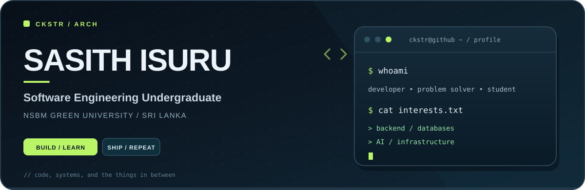

  

   

  **Software Engineering · Open Source · Always Learning**

  
  

---

### `01` / About me

I'm **Sasith Isuru**, a Software Engineering undergraduate at **NSBM Green University, Sri Lanka**. I enjoy figuring out how things work, then building something useful with what I've learned.

Most of my time goes into **backend development, databases, algorithms, and Linux tooling**. I'm also exploring **AI/ML** and the infrastructure behind real-world applications.

### `02` / What I'm building

| Project | What it is |
| :--- | :--- |
| **[NSBM SportsHub](https://github.com/Ckstr-arch/TestENV)** | A campus sports platform with club communities, tournaments, reservations, dashboards, and authenticator-based 2FA. Built with PHP, JavaScript, and MySQL/MariaDB. |
| **Hosting & infrastructure lab** | Hands-on experiments with Linux, Docker, Apache virtual hosts, and web deployment. |

### `03` / Tech I use

**Languages**

**Tools & environment**

### `04` / Find me elsewhere

---

  <code>~/ckstr-arch $</code> learn → build → improve

